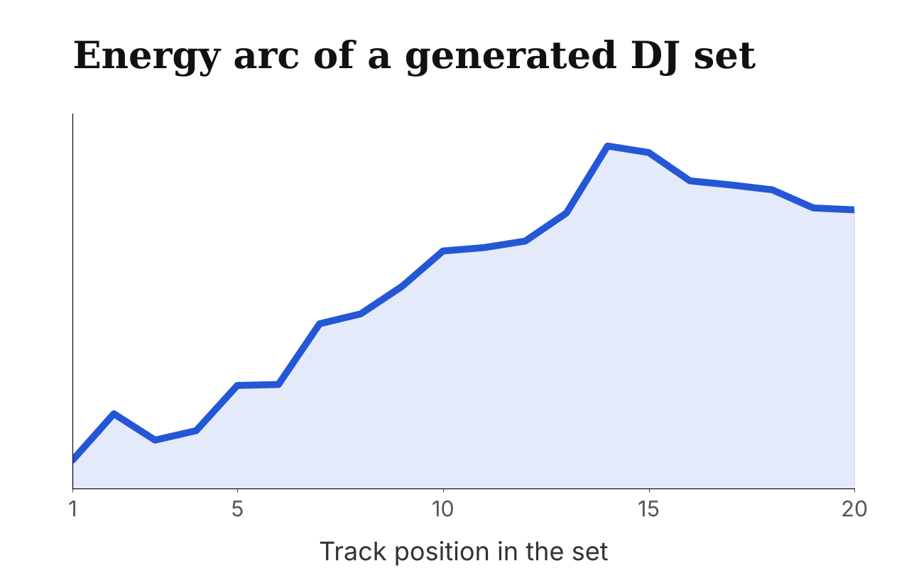
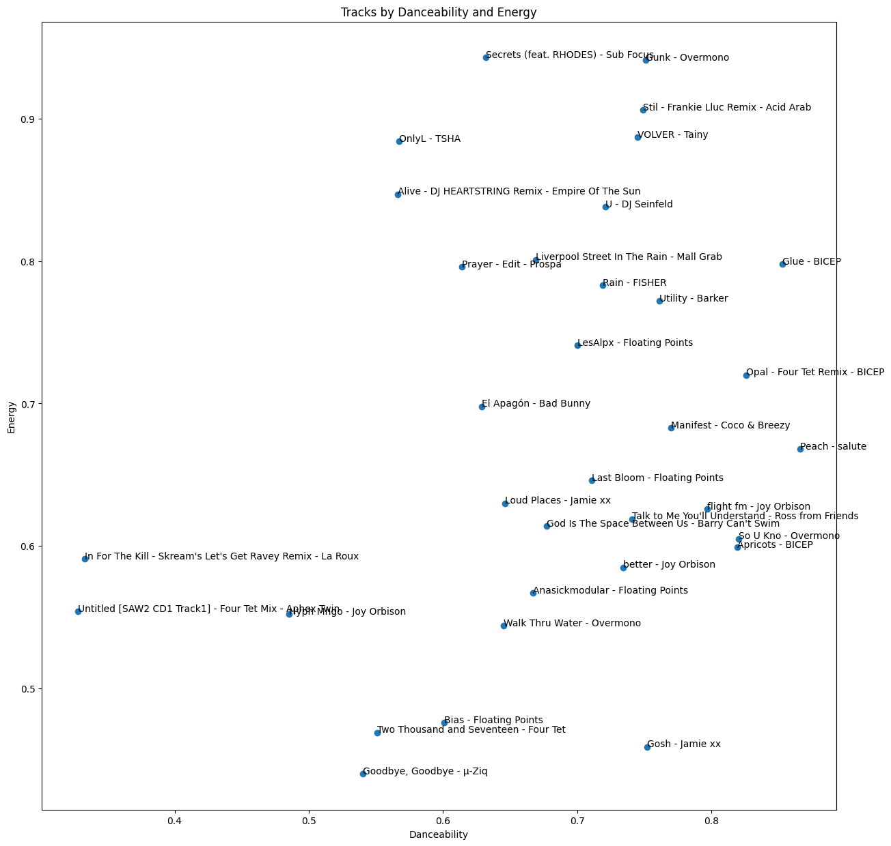
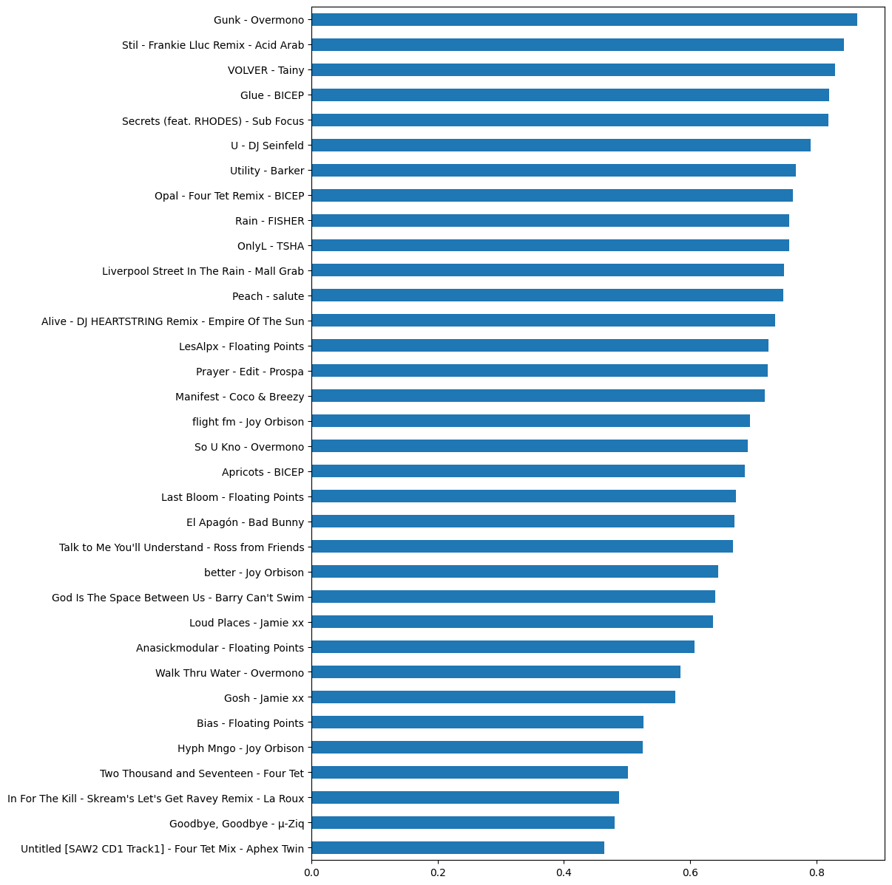
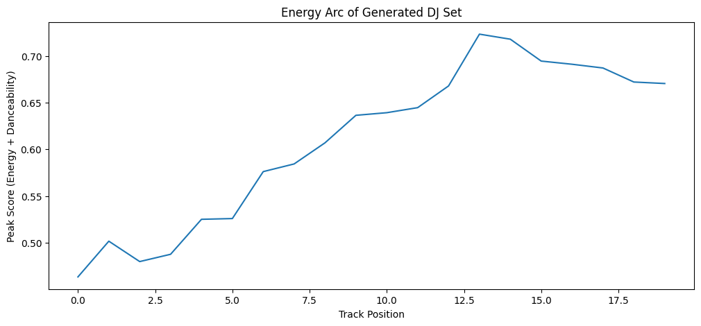
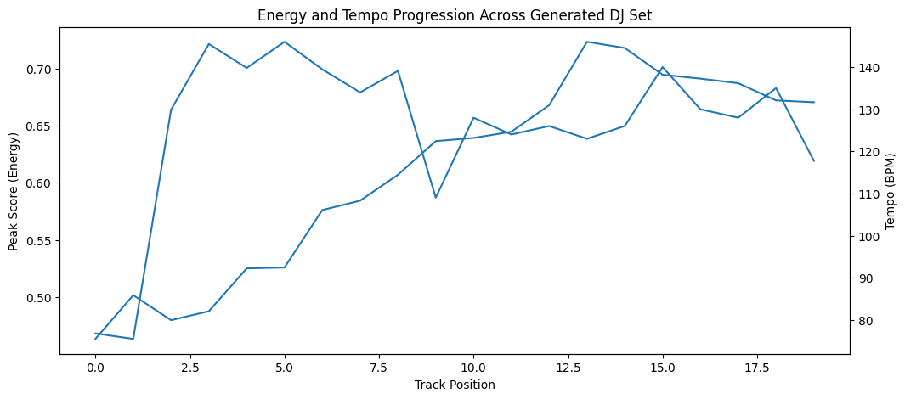
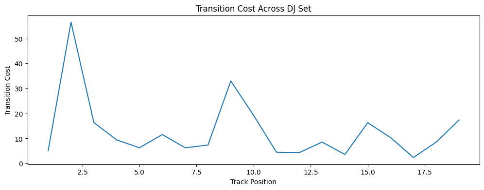

# DJ-Set: Spotify DJ Playlist Generation

**A data science tool that helps DJs plan a set from a playlist.** It scores each track on energy and danceability, orders the tracks into the arc of a real DJ set, with a build, a peak and a wind-down, and flags the transitions that will need the most work when mixing.

  

## Why

Building a DJ set from scratch is hard. Software such as Rekordbox suggests similar tracks by BPM and key, but it doesn't help with the shape of a whole set. A well-built set starts slowly, builds excitement, reaches a peak, and then either holds that energy or winds back down. This project turns that idea into something measurable. Its focus is on the flow and the transitions, not on recommending songs.

## How it works

1. **Get a playlist.** Tracks are read with the Spotify API (`spotipy`), and audio features for each track come from the ReccoBeats API. Only some tracks can be matched, so the project works with the ones that are found (34 of 40 for the example playlist).
2. **Look at the data.** Danceability, energy and tempo are explored for every track. Tempo is only used to check transitions, because DJ software already handles it well.
3. **Peak score.** One number per track combines the two features that matter most for how a set feels: `peak_score = 0.6 × energy + 0.4 × danceability`. Energy is weighted a little higher because it matters more at the peak moments of a set.
4. **Build the arc.** Tracks are sorted by peak score and split so the peak sits about **70%** of the way through the set. The tracks up to the peak go in ascending order (the build), and the rest go in descending order (the drop). A shorter set can be made with a chosen number of build and drop tracks, for example 13 and 7.
5. **Transition cost.** For every pair of neighbouring tracks, `transition_cost = BPM difference + 100 × peak score difference` flags the roughest mixes. Tracks with very low tempo are moved to the start as an intro.

   
  <em>Every track plotted by danceability and energy.</em>

   
  <em>Tracks ranked by peak score.</em>

## Results

The generated set starts low, builds steadily, peaks around track 13 of 20 and then comes back down. The transition cost chart shows where mixing will need the most care, so a DJ can see at a glance which transitions to practise.

   
  <em>The energy arc of the generated 20-track set.</em>

   
  <em>Energy and tempo across the set.</em>

   
  <em>Transition cost between neighbouring tracks. Spikes show where mixing needs the most care.</em>

## Setup

- Python with `spotipy`, `requests`, `pandas`, `numpy`, `scikit-learn` and `matplotlib`
- A Spotify developer app. Put its client ID and secret in environment variables (`SPOTIPY_CLIENT_ID` and `SPOTIPY_CLIENT_SECRET`) and **never** commit them to the repo
- Open `dj-set.ipynb`, set `playlist_id` to your playlist and run the cells in order

## Repository

| File | Contents |
|------|----------|
| `dj-set.ipynb` | The whole project: data, peak score, set order, transitions and plots |

## Author

Daria Cotocu · [dariacotocu.com](https://dariacotocu.com)
